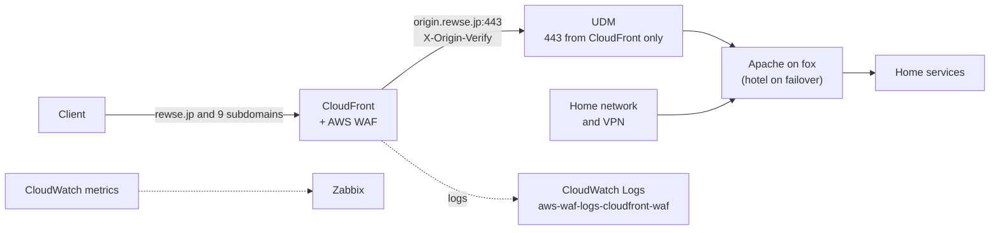

# cloudfront-waf

This repository puts Amazon CloudFront and AWS WAF in front of the services that run at home on fox, a Raspberry Pi, with hotel as its Home Assistant standby. One CloudFormation stack in `us-east-1` holds the distribution, the web ACL, the certificate, and the WAF logs. The Apache and UniFi Dream Machine (UDM) settings that lock the origin to CloudFront live in [`rewse/ansible-playbooks`](https://github.com/rewse/ansible-playbooks).

## How it works



The public names are `rewse.jp` and `couchdb`, `grafana`, `hass`, `litellm`, `nas`, `nvr`, `teslamate`, `www`, and `zabbix` under it. In the public zone, each one points at the distribution. The distribution has one origin, `origin.rewse.jp`, which resolves to the home WAN address. It does no caching and forwards every viewer header, so Apache behaves as it did before CloudFront was in front of it. The origin read timeout is 60 seconds.

Inside the home network and from the VPC behind the VPN, the same names resolve to fox's private address, so those clients do not pass through CloudFront.

Three layers keep requests from reaching the origin without passing through the WAF:

- **Origin header.** CloudFront adds a secret `X-Origin-Verify` header to every origin request. Apache answers 403 to any request without it, except from loopback, the home network, and the VPN.
- **UDM.** WAN port 443 accepts only the CloudFront origin-facing ranges from `ip-ranges.json`. Port 80 and the IPv6 web ports are closed. SSH stays open.
- **Client address.** `mod_remoteip` trusts `X-Forwarded-For` only from the CloudFront origin-facing ranges, so Apache logs, `Require ip`, and fail2ban see the real client. A fail2ban ban also makes Apache deny the address, because the host firewall only sees CloudFront.

## WAF rules

The web ACL evaluates the rules in this order. Rules marked *count* only label and log until `BlockManagedRules` is turned on.

| Rule | Action |
|---|---|
| `AllowSecurityAgentPentest` | Allow requests that carry the secret `X-Security-Agent-Pentest` header of [`rewse/security-agent`](https://github.com/rewse/security-agent) |
| Amazon IP reputation list | Block with `BlockManagedRules`, otherwise count |
| Anonymous IP list | Block with `BlockManagedRules`, otherwise count. `HostingProviderIPList` always counts |
| `RateLimitLogin` | Block more than 100 requests per IP in 5 minutes to `/auth/`, `/login`, or `/api/login` |
| `RateLimitAll` | Block more than 3,000 requests per IP in 5 minutes |
| Known bad inputs, core rule set, Linux, Unix, PHP | Block with `BlockManagedRules`, otherwise count. `SizeRestrictions_BODY` and `NoUserAgent_HEADER` always count |
| Bot Control (common) | Block with `BlockManagedRules`, otherwise count. `CategoryHttpLibrary` and `SignalNonBrowserUserAgent` always count |
| `GeoLabel` | Count and label requests from outside Japan that do not come from the Amazon corporate network |

The sub-rules that always count match legitimate API callers: Home Assistant webhooks sent by Go-http-client, and Alexa and Tesla, which call too rarely for a count period to show them.

## Monitoring

Zabbix is configured in Zabbix itself; the agent side is in `rewse/ansible-playbooks`.

- **MyTemplate AWS CloudFront WAF** (on alfa). The `zabbix_aws` role runs `cloudfront_waf.sh` every 5 minutes. It reads the distribution's requests, 4xx and 5xx error rates, and origin latency, and the web ACL's allowed, blocked, and counted requests. It raises a High problem when the 5xx error rate stays above 5% for 15 minutes with at least 30 requests. It raises a Warning when more than 500 requests are blocked in 5 minutes, or when no request arrives for 30 minutes.
- **MyTemplate App Apache CloudFront** (on fox and hotel). Once a day it reads `apache.remoteip.missing_prefixes`, the number of CloudFront origin-facing prefixes that Apache does not trust yet, and raises a Warning when it is not zero. See [Watch for new CloudFront ranges](#watch-for-new-cloudfront-ranges).

## Read the WAF logs

The web ACL logs to the CloudWatch Logs group `aws-waf-logs-cloudfront-waf` in `us-east-1`, kept for 90 days. The `authorization` and `cookie` headers and the pentest header are redacted. In CloudWatch Logs Insights, select the group and a time range, then run:

```
parse @message /"ruleGroupId":"(?<group>[^"]+)","terminatingRule":[^\[]*"nonTerminatingMatchingRules":\[\{"ruleId":"(?<rule>[^"]+)"/
| filter ispresent(rule)
| stats count(*) as requests by group, rule
| sort requests desc
| limit 25
```

`ruleGroupList` holds every rule group the web ACL evaluated, in order, whether or not it matched. The query therefore parses the raw message for the first group whose `nonTerminatingMatchingRules` is not empty, and reports that group and its first matching sub-rule. A request that matched in several groups is counted once, under the first. To see blocked requests instead, run `stats count(*) by terminatingRuleId, httpRequest.clientIp, httpRequest.uri` with `filter action = "BLOCK"`. Rules attached directly to the web ACL, such as `GeoLabel`, appear in the top-level `nonTerminatingMatchingRules`.

When a sub-rule flags legitimate traffic, add a rule action override for it in `infra/template.yaml` before you turn on blocking.

## Turn on blocking

`BlockManagedRules` is `"false"` in `infra/parameters.json`. Set it to `"true"` once the count period shows no false positives. The IP reputation list, the Anonymous IP list, and the other managed groups then block. The sub-rules listed under [WAF rules](#waf-rules) keep counting either way, through the rule action overrides in `infra/template.yaml`.

`aws cloudformation deploy` keeps the previous value of a parameter it is not given, so changing a template `Default` alone never reaches the stack. Change the value in `infra/parameters.json` and the matching `Default` in `infra/template.yaml` (the tests check that the two agree). Commit both, and run `AWS_PROFILE=admin scripts/deploy.sh`. To go back, set both to `"false"` and deploy again.

## Rotate a secret

The egress CIDRs change in 1Password and take effect on the next deploy. After changing them, also apply the `httpd_conf` tag to fox and hotel and the `zabbix_server_frontend` tag to fox. Apache renders the same list into the `/admin`, `/server-status`, and `/zabbix` allowlists.

The pentest header has three copies besides 1Password: the WAF allow rule in this stack, `security-agent-pentest.conf` in Apache (fail2ban never bans an address that sent the header), and the Secrets Manager secret `security-agent/pentest-header` that `rewse/security-agent` sends with each pentest. After changing the password in 1Password, update all three:

1. Deploy this stack.
2. Apply the `httpd_security_agent` tag to fox and hotel.
3. Copy the value to Secrets Manager and trigger an update of `HomePentest`, as the last paragraph of step 10 in `docs/setup.md` of `rewse/security-agent` describes:

   ```sh
   op read -n op://ansible/m6obpvalg7ekdi5nsf4yx6wi3q/password | AWS_PROFILE=admin aws secretsmanager put-secret-value \
     --region us-east-1 --secret-id security-agent/pentest-header --secret-string file:///dev/stdin
   ```

Until the three agree, the WAF blocks the pentest or fail2ban bans it partway through a run.

The origin verification header has to change in the order below. While CloudFront and Apache hold different values, Apache answers 403 to every request that arrives through CloudFront.

1. Set `httpd_cloudfront_origin_enforce` to `false` and apply the `httpd` role to fox and hotel.
2. Update the password of "Amazon CloudFront - Origin Verify" in 1Password.
3. Deploy the stack, which gives CloudFront the new value.
4. Apply the `httpd` role to fox and hotel so Apache reads the new value.
5. Set `httpd_cloudfront_origin_enforce` back to `true` and apply the `httpd` role again.

## Watch for new CloudFront ranges

AWS adds CloudFront origin-facing ranges to `ip-ranges.json` from time to time. The `mod_remoteip` trust list, the fail2ban exemption, and the UDM address group take them in only when Ansible runs. Until then, the UDM refuses a request from an edge server in a new range.

The Zabbix item `apache.remoteip.missing_prefixes` on fox and hotel counts the origin-facing prefixes in `ip-ranges.json` that `remoteip.conf` does not trust. It returns nothing when either cannot be read. When its trigger fires, apply the `httpd_remoteip` tag to fox and hotel and the `udm_cloudfront` tag to the UDM.

## Repository layout

| Path | Contents |
|---|---|
| `infra/template.yaml` | The CloudFormation stack: distribution, web ACL, certificate, log group, and the `origin.rewse.jp` record |
| `infra/parameters.json` | The parameters that are not secret, passed on every deploy |
| `scripts/deploy.sh` | Deploys the stack with the secrets read from 1Password |
| `scripts/switch-dns.sh` | Points the public names at the distribution or back at the origin |
| `tests/` | Template, script, and public-repository checks |
| `docs/setup.md` | The runbook that deploys the stack and cuts the names over, with the rollback |
| `docs/superpowers/` | The design spec and the implementation plan, in Japanese |

## Development

See [AGENTS.md](AGENTS.md) for the validation commands and the rules for secrets.
