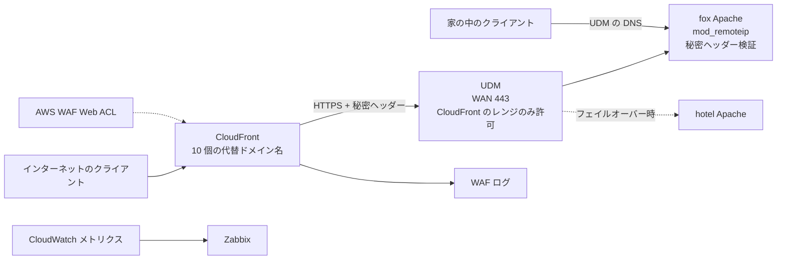

# 自宅サービスの前段に CloudFront と AWS WAF を置く設計

## 目的

fox（自宅の Raspberry Pi）で動くサービスは、UDM の WAN ポートフォワードでインターネットから直接届いている。守りはアプリ自身の認証と、fail2ban によるログイン失敗の後追い遮断だけで、公開しているアプリはどれも自分では直せないサードパーティ製である。前段に CloudFront と AWS WAF を置き、既知の攻撃パターン、評判の悪い送信元、スキャナーを入口で落とす。WAF を迂回できる経路が残ると効果が薄いので、自宅への直接アクセスは CloudFront 経由以外を閉じる（オリジンロック）。

所有者は AWS の SA で、dogfooding を兼ねる。ただし、dogfooding を理由に機能を採用しない。この環境に合うものだけを使う（所有者の判断）。費用はあまり気にしなくてよい（所有者の判断）。

## 現状

2026-10-22 時点で ansible-playbooks、fox、Route 53 を読んで確かめた事実。

- fox の Apache が name-based vhost で各サービスを localhost のコンテナへ mod_proxy している。TLS は Let's Encrypt の `rewse.jp` と `*.rewse.jp`（certbot-dns-route53）。
- インターネットからは UDM（sierra）の WAN 443/80 ポートフォワードで届く。HA のフェイルオーバーでは、`homeassistant-name-switch`（hotel 上）が UDM の内部 CNAME と 443/80 のフォワード先を hotel に切り替える。
- 公開ゾーン `rewse.jp`（`Z34LVKL0P9KD74`）で fox を向いている名前は、`rewse.jp`、`www`、`hass`、`nas`、`nvr`、`couchdb`、`litellm`、`teslamate`、`grafana`、`zabbix`。`rewse.jp` と fox の A は WAN IP `106.163.184.9`、fox の AAAA は fox 自身のグローバル IPv6 で、IPv6 は NAT を通らず直接届く。
- 家の中のクライアントは UDM の DNS で fox のプライベート IP を引く。AWS の VPC（`10.0.0.0/16`）とは UDM の VPN でつながっていて、VPC の中のクライアントもプライベートゾーンで fox のプライベート IP を引く。
- UDM の WAN から開いているのは、IPv4 では 443 と 80（fox、HA のフェイルオーバー時は hotel）、11022（fox の SSH）、21022（hotel の SSH）。IPv6 では fox への 443、80、11022 と、hotel への 21022。SSH は公開鍵認証のみで、パスワード認証と root ログインは無効。
- デフォルト vhost（`rewse.jp`）には全 vhost 共通の conf が載っている。旧ブログ `/blog/...` から `blog.rewse.jp` へのリダイレクト、`/zabbix`、`/autodiscover`（AWS の autodiscover へプロキシ）、`/admin`、`/server-status` がある。
- `/admin`、`/server-status`、`/zabbix` は Apache の `Require ip` で守られている。許可リストは ansible-playbooks の `inventory/group_vars/all/site.yml` の `networks` から描画される。そこには、自宅のアドレス、AWS 上のアドレス（`aws_private_ipv4`、`aws_public_ipv6`）、Amazon 社内ネットワークの出口（`office_public_ipv4`）が並んでいる。
- サービスごとに fail2ban の jail があり、`other_vhosts_access.log` の接続元 IP で締め出す。
- AWS Security Agent が、fox のサービスにオンデマンドのペンテストをかけている（`rewse/security-agent`。週次のペンテストの対象は `blog.rewse.jp`）。ペンテストは秘密の値を持つ `X-Security-Agent-Pentest` ヘッダーを送り、fox の fail2ban はそれを送ってきたアドレスを締め出さない。値は 1Password と Secrets Manager にある。

直近 2 週間のアクセスログから分かったこと。

- 日本以外からのアクセスの大半は、Security Agent のペンテストだった。
- 本人の HA iOS アプリが、Amazon 社内ネットワークの出口（US 判定）と SG からも Webhook、WebSocket、`/auth/token` を叩いていた。日本だけに絞るジオ制限を入れると壊れる。
- `54.64.81.21`（東京リージョンの EC2、`Go-http-client/1.1`）が、HA の Webhook をひとつの ID でおよそ 1 分おきに POST し、毎回 200 と約 4KB の本文を受け取っている。その ID は HA の設定のどこにも見当たらず、正体は分かっていない。
- Alexa の smart home（`/api/alexa/smart_home`）への外部からの呼び出しと、Tesla の公開鍵の取得は、この期間には 0 件だった。どちらも設定上は有効である。
- `nvr` と `nas` は SPA で、どんなパスにも 200 を返す。スキャナーの試行もログ上は成功に見える。

## 目標

- 上の 10 個の名前へのインターネットからのリクエストが、すべて CloudFront と WAF を通る。
- 自宅の WAN IP（IPv4）とグローバル IPv6 に直接来た 80 / 443 の通信は届かない。家の中と、VPN の向こうの所有者の VPC からの通信は除く。
- 本人の利用、HA アプリ、外部連携は、どこにいても今まで通り動く。
- fail2ban と Apache の `Require ip` が、本当のクライアント IP で今まで通り効く。
- WAF が止めた件数と CloudFront のエラーを Zabbix で見て、アラートを受けられる。
- AWS 側の定義を公開リポジトリ `rewse/cloudfront-waf` に置く（所有者の判断）。

## 非目標

- `blog.rewse.jp`。Amplify のアプリ `rewse-blog` で配信していて、Amplify が作った Web ACL（IP reputation、Core rule set、Known Bad Inputs）がすでに付いている。
- 家の中から fox への経路。今まで通り直接つなぐ。
- ブログ記事などの対外発信（所有者の判断）。
- Shield Advanced、Account Takeover Prevention、viewer mTLS、CloudFront のフラットレート料金プラン。どれもこの環境には合わないと判断した（こちらの判断）。ATP については、HA のログインが独自の JSON フローで、fail2ban がすでに効いているため。viewer mTLS は、HA アプリや Tesla の通信が通らなくなるおそれがあるため。フラットレートプランは、従量課金で困ることがなく、ルールの自由度が下がるおそれがあるため。

## 失敗とみなすもの

- HA アプリ、Webhook を使う統合、Alexa、Tesla Fleet のどれかが黙って壊れる。
- `mod_remoteip` が `X-Forwarded-For` を無条件に信頼し、許可リストや fail2ban を偽装で迂回できる。
- 海外や社内ネットワークから、所有者が自分のサービスを使えなくなる。
- 秘密の値や社内ネットワークの情報が公開リポジトリに載る。

## 構成

## 決まっていること

### 置き場所

- AWS 側（CloudFront、WAF、ACM 証明書、WAF ログの出力先、Route 53 の公開レコード）は、`rewse/cloudfront-waf` の CloudFormation で us-east-1 に置く。デプロイは security-agent と同じく `aws cloudformation deploy` で行う。CloudFront 用の WAF は us-east-1 にしか作れない。
- 自宅側（Apache、UDM）は ansible-playbooks のロールに入れる。`httpd` に `mod_remoteip` と秘密ヘッダーの検証を足し、`udm` に WAN のファイアウォールを足す。ansible-playbooks の AGENTS.md の規約に従う。
- Zabbix の設定は Zabbix を直接編集する（所有者の判断）。

### 秘密の値

1Password を正とする（所有者の判断）。security-agent と同じく、1Password の `ansible` vault に置き、AWS 側には `op read ... | aws secretsmanager ...` で写し、CloudFormation からは参照で読む。Ansible は `lookup('pipe', 'op read op://ansible/...')` で 1Password から直接読む。対象は次の 3 つ。

- オリジン検証用の秘密ヘッダーの値（新規）。
- ペンテストの `X-Security-Agent-Pentest` の値（既存の項目をそのまま使う）。
- Amazon 社内ネットワークの出口の CIDR リスト（新規）。いまは公開リポジトリ ansible-playbooks の `site.yml` に、社内 wiki へのリンクと一緒に書かれている。1Password へ移して `site.yml` からは消し、Apache の `Require ip` と WAF の IP セットの両方が 1Password のこの項目を読むようにする。git の履歴は書き換えない（所有者の判断）。

自宅の WAN IP は公開 DNS に出ているので、秘密として扱わない。

### CloudFront

- ディストリビューションは 1 つ。代替ドメイン名に 10 個の名前を並べ、ACM の `rewse.jp` と `*.rewse.jp` の証明書（us-east-1、DNS 検証）を付ける。
- キャッシュは無効。すべての HTTP メソッドを通し、Host ヘッダー、クエリ文字列、Cookie を含めてビューワーのリクエストをそのままオリジンへ渡す。Apache の vhost による振り分けを今のまま使うため。
- オリジンは `origin.rewse.jp`。公開ゾーンに WAN IP の A レコードだけを作り、AAAA は作らない。ワイルドカード証明書がそのまま通り、フェイルオーバーで UDM のフォワード先が hotel に変わっても追従する。オリジンへは HTTPS のみで接続する。
- オリジンへのリクエストに秘密ヘッダーを付ける。
- ビューワー側の HTTP は HTTPS へリダイレクトする。
- WebSocket（HA、LiteLLM、TeslaMate、Frigate）、CouchDB のロングポール、`nas` の大きいアップロード、`nvr` のストリーミングが通るように、オリジンのタイムアウトを決める。

### DNS

- 公開ゾーンで、サブドメインの 8 つは CloudFront への CNAME に、`rewse.jp` と `www` は CloudFront への alias レコードに変える。
- fox、hotel、sierra、zulu の A / AAAA はそのまま残す。
- プライベートゾーンと UDM の内部 DNS には触らない。

### WAF のルール

上から順に評価する。

1. `X-Security-Agent-Pentest` の値が一致すれば Allow。ペンテストは WAF を素通りさせて、アプリ自体の弱点を見る（所有者の判断）。
2. AWS の IP reputation リストと Anonymous IP リストは Block。ただし、Anonymous IP リストのうち `HostingProviderIPList` は Count にする。EC2 や Lambda から来る正規の呼び出し元（`54.64.81.21`、Alexa のバックエンド、たぶん Tesla）に当たるうえ、Alexa と Tesla は呼び出し頻度が低くて、Count の期間に誤検知が見えないため（こちらの判断）。
3. Known Bad Inputs、Core rule set、Linux / POSIX、PHP（Zabbix の UI のため）、Bot Control の Common レベルは、まず Count で入れる。ログを見て誤検知を外してから Block にする。HA の Webhook、CouchDB、`nas` のアップロードは本文が大きいので、本文のサイズ制限のルールはこれらのパスで外す前提で調整する。
4. ジオ判定は Count とラベル付けにとどめる。日本と、社内の出口の IP セットのどちらかに当たればラベルを付け、遮断には使わない。
5. レートベースのルールを IP 単位でかける。ログイン系のパス（HA の `/auth/`、Grafana の `/login`、filebrowser、Frigate のログイン API）は厳しめにする。1 分おき程度の Webhook には引っかからない値にする。
6. デフォルトは Allow。

WAF のログを出力先（CloudWatch Logs か S3）に出し、Count の期間はそれを見て調整する。

### Apache

- `mod_remoteip` を有効にし、信頼するプロキシは CloudFront のオリジン向け IP レンジ（`ip-ranges.json` の `CLOUDFRONT_ORIGIN_FACING`）だけにする。これで、アクセスログ、fail2ban、`Require ip` のすべてが本当のクライアント IP を見る。
- 秘密ヘッダーのないリクエストは、拒否する。ただし、家の中のアドレス（`192.168.0.0/24` と自宅の IPv6 プレフィックス）、VPN の向こうの AWS のアドレス（`aws_private_ipv4` と `aws_public_ipv6`）、loopback は除く。VPN の向こうは所有者の VPC なので、家の中と同じ扱いにする（所有者の判断）。fox と hotel の両方に入れる。
- `/admin`、`/server-status`、`/zabbix` の許可リストのうち社内の出口の部分は、1Password の項目から描画する。

### UDM

- WAN からの 443 は、CloudFront のオリジン向け IP レンジだけを許可する。
- WAN からの 80 は受けない。CloudFront がビューワー側で HTTPS へリダイレクトし、certbot は DNS 検証なので、80 は不要になる。`homeassistant-name-switch` は 80 のフォワードがないと失敗扱いにするので、`homeassistant_ha_secondary` も合わせて直す。
- IPv6 では、fox への 80 / 443 を WAN から受けない。
- SSH の 11022 と 21022 は、IPv4 と IPv6 ともに今のまま開けておく。CloudFront では SSH を中継できず、公開鍵認証のみで fail2ban の sshd の jail もあるため（こちらの判断）。
- CloudFront のレンジは Ansible の実行時に `ip-ranges.json` から取る。

### 切り替えの順番

止めずに移るため、次の順で進める。

1. CloudFormation をデプロイする。WAF は Allow ルールとレートベースのルール以外を Count にしておく。
2. fox と hotel の Apache に `mod_remoteip` を入れ、秘密ヘッダーはまだ検証しない。
3. 公開 DNS を CloudFront に切り替え、下の確認項目を通す。
4. Apache で秘密ヘッダーの検証を有効にする。
5. UDM の WAN ファイアウォールを閉じる（IPv4 と IPv6）。
6. 1〜2 週間、ログを見て Count のルールを調整し、Block に切り替える。

各段で、前の段に戻す手順を持っておく。

### 監視

CloudWatch のメトリクスを Zabbix に取り込む。alfa の `zabbix_aws`（agent の UserParameter、aws-cli、`zabbix_sender`）と、`zabbix_agent/files/ec2.sh` が GetMetricData を呼ぶやり方にそろえる。対象は、WAF の Blocked / Counted（ルールごと）、CloudFront の 4xx / 5xx のエラー率、オリジンのレイテンシー。アラートの条件は Zabbix で直接設定する。

## 確認項目

切り替え後、少なくとも次を確かめる。

- 10 個の名前すべてで、ブラウザからログインして使える。
- HA の iOS アプリが、家の外のモバイル回線、社内ネットワーク、Webhook、WebSocket で動く。
- WebSocket が HA、LiteLLM、TeslaMate、Frigate で張れる。CouchDB の同期（ロングポール）が続く。
- `nas` で大きいファイルをアップロード・ダウンロードできる。`nvr` でライブ映像と録画を再生できる。
- Tesla の公開鍵（`hass.rewse.jp/.well-known/appspecific/com.tesla.3p.public-key.pem`）が外から取れる。
- Alexa から HA のデバイスを操作できる。
- `54.64.81.21` からの Webhook が引き続き 200 で返る。
- `rewse.jp/blog/...` のリダイレクトと `/autodiscover` が動く。
- `/admin`、`/server-status`、`/zabbix` が、許可リストの中からは開けて、外からは拒否される。`X-Forwarded-For` を偽装しても拒否される。
- fail2ban が本当のクライアント IP で締め出す。
- 自宅の WAN IP と fox の IPv6 に直接つなぐと、80 / 443 がつながらない。
- AWS の VPC の中から、今まで通り fox に直接つながる。
- 家の中からは、今まで通り fox に直接つながる。
- HA のフェイルオーバーで hotel に切り替わっても、CloudFront 経由で HA が使える。
- 自宅サービスへのオンデマンドのペンテストが、WAF に止められずに最後まで走る。

## 未解決

- `54.64.81.21` から HA の Webhook を叩いているものの正体。CloudFront 経由になれば WAF ログにリクエストの詳細が残るので、そこから追う。
- 範囲の外で見つけたもの。fox の `/etc/apache2/conf-enabled/nextcloud.conf` が、リンク先のないシンボリックリンクとして残っている。Amplify が作った Web ACL のうち、`d1g9n4274gdgdc` のものがどのリソースにも関連付いていない。RDS のエンドポイントへの CNAME が公開ゾーンにある。

## 作り手に任せること

- CloudFormation のテンプレートの分け方、パラメータの形、Secrets Manager の値を CloudFormation に渡す方法。値をリポジトリに書かない、という制約は守る。
- マネージドルールのバージョン、ルールごとの除外、レートのしきい値、オリジンのタイムアウトの具体的な値。
- WAF ログの出力先と保持期間。
- `ip-ranges.json` の取り込み方と、UDM のファイアウォールを Ansible から操作する方法。
- 公開リポジトリとしての `.github` 一式。`~/git/AGENTS.md` の GitHub の規約に従う。
